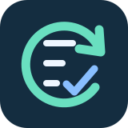

<p align="center"></p>

# Runtime Recovery Kit

[繁體中文](README.zh-TW.md) · [Agent entry](AGENTS.md) · [Skill](SKILL.md) · [CI](https://github.com/lzhs1995/runtime-recovery-kit/actions/workflows/checks.yml)

Practical recovery notes for agent startup, tool discovery, terminal input modes and interrupted tasks. Diagnose the failed layer, retain the original task and verify the actual operation after a repair.

This kit contains portable Markdown, terminal recovery functions and adapters, a Codex writer-lock observer, package diagnostics, an explicit-layout client manager, startup launcher, configured dispatcher and DSH terminal adapter. It does not bundle Codex, Herdr, a DSH SDK, model providers, private configuration or session records. Automatic session recovery is outside this edition.

## Start

Get the complete repository from [lzhs1995/runtime-recovery-kit](https://github.com/lzhs1995/runtime-recovery-kit). Ask your agent to read `AGENTS.md` and `SKILL.md`; they link the same workflow for Codex, Claude Code, Gemini CLI and other Markdown-capable agents. Automatic discovery differs by client. There is no installer.

The documents are platform independent. The terminal function requires Bash or Zsh and a compatible terminal emulator; the command uses Bash and the optional prompt hook uses Zsh. The observer requires POSIX Python and a Codex version with the matching native lock contract; see [writer observation](references/writer-observation.md). Native Windows is outside these scripts' scope. macOS signing and native applications require separate tools.

## Terminal input-mode recovery

At an interactive shell prompt after the affected program has returned terminal control, run from this directory:

```sh
. ./scripts/terminal_modes.sh
if [ -t 0 ] && [ -t 1 ]; then
    codex_toolchain_reset_terminal_modes
fi
```

Sourcing the file only defines the function. Calling it writes escape sequences to reset mouse, focus, bracketed-paste and keyboard input modes and show the cursor. It does not erase the screen, history or input buffer. Do not run it repeatedly inside a live TUI or inject it into another agent's input. It does not reset all terminal attributes or repair a crashed application.

For the manual command and an optional Zsh prompt integration, read [terminal integration](references/terminal-integration.md). Both adapters load the included function from their own directory; no machine-specific installation path is required. The Zsh hook retains its original interactive TTY and `CMUX_SURFACE_ID` conditions. Its presence marker is not identity authentication.

The [package helper layout library](references/package-layout.md) checks that the helper selected from explicit package and entry paths is the same file as the package helper. This is one extracted client-management function; it does not verify signatures or provide the full client updater.

The [doctor with explicit layout](references/doctor-layout.md) checks supplied configuration, package-helper paths and macOS signatures. It has no implicit installation paths; cache and report files are written only when their paths are selected. `--startup` retains the original nonblocking, potentially pending signature result.

The optional [Codex client manager](references/codex-client.md) separates configuration validation, native status inspection, action planning and explicit application. Its original signed-package update transaction is limited to the supported macOS Apple Silicon package. Supply every installation path and the free-space threshold through a private layout; applying an update downloads, switches aliases and may retire the exact previous owned package. A saved plan performs none of those checks or changes.

## Diagnose and verify

Read [recovery layers](references/recovery-layers.md) for the shortest check at each layer, and [source scope](references/source-scope.md) for included and deferred modules. Preserve existing task authorization and the original controller, session, attempt and result. Unknown results need reconciliation before retrying.

A configuration file parsing, a tool being installed, a client loading it and a successful task are separate outcomes. Report the observed outcome and the still-unverified boundary. Do not call application access or a completed model stream scientific acceptance.

## Verification

The original function and observer remain byte-for-byte unchanged. Their 11 synthetic tests and fixed-commit CI evidence remain the baseline. Two terminal adapters change only the function source path to a package-relative path. Separate adapter tests cover relocated directories, non-TTY silence, command errors, prompt-hook deduplication and exit-status preservation; see [the fixture boundaries](references/validation.md). These tests use pipes and temporary directories, with no live history, real terminal reset, client, application or model. Run `python3 -B -m unittest discover -s tests -v` from the root.

The [GitHub Actions workflow](https://github.com/lzhs1995/runtime-recovery-kit/actions/workflows/checks.yml) runs the fixture suite on Linux/macOS with Python 3.11/3.14. Follow the workflow link for the actual results of each commit.

No universal agent or native-platform support is claimed. The original modules had no license declaration; this edition adds no new license and redistributes no third-party binary.

## Configured adapter dispatch

The optional [adapter dispatcher](references/agent-dispatch.md) replaces itself with an argv selected from your explicit private configuration. It forwards arguments unchanged and preserves an inherited `HERDR_AGENT` unless an exact label is configured. It launches the configured program; no agent CLI, model, profile or session is bundled.

## Startup launcher with explicit layout

The optional [startup launcher](references/toolchain-launch.md) runs the supplied doctor and finally replaces itself with the configured CLI, preserving the original arguments and PID. Supply all paths in a private layout file. It writes the selected doctor report and calls terminal recovery only when stdin and stdout are both TTYs. Startup-check failure still permits the CLI to run; continuing is not proof of repair. No CLI binary, session choice or model default is bundled.

## DSH terminal adapter

The optional [DSH adapter](references/dsh-adapter.md) starts an explicitly configured external DSH binary and profile. It retains the original session events, shutdown behavior and name-only handshake; Herdr reporting is disabled or configured through a private env view. The source survey's npm `0.2.1-rc.2` and wire `0.0.1` are separate static observations, not a real initialize result. No SDK, model/provider configuration or session is bundled. Run its new Node fixtures separately with `node --test tests/test_herdr_dsh.mjs`.
