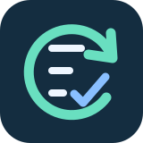

<p align="center"></p>

# Runtime Recovery Kit · Agent 恢復工具

[English](README.md) · [Agent 入口](AGENTS.md) · [技能](SKILL.md) · [CI](https://github.com/lzhs1995/runtime-recovery-kit/actions/workflows/checks.yml)

這份指南整理 agent 啟動、工具探索、終端輸入模式及任務中斷的恢復方法。先定位失敗層、保留原任務，再以實際操作核驗修復效果。

本工具集包含通用 Markdown 文件、Bash／Zsh 終端函式、手動終端命令、可選的 Zsh 提示符 hook，以及 Codex 寫入鎖觀測模組，不包含 Codex、Herdr、模型服務、客戶端設定或會話記錄。完整套件更新、自動會話恢復與 DSH 橋接不在這一版內。

## 開始使用

從 [lzhs1995/runtime-recovery-kit](https://github.com/lzhs1995/runtime-recovery-kit) 取得完整目錄後，請 agent 閱讀 `AGENTS.md` 與 `SKILL.md`。Codex、Claude Code、Gemini CLI 及其他可讀 Markdown 的 agent 都由同一入口閱讀；客戶端自動探索行為仍須另外確認。本工具集沒有安裝器。

文件不限定平台；終端函式需要 Bash 或 Zsh 及相容的終端模擬器，手動命令使用 Bash，可選提示符 hook 使用 Zsh。觀測模組需要 POSIX Python 及符合原生鎖定契約的 Codex 版本，詳見[寫入鎖觀測](references/writer-observation.md)。這些腳本不適用於原生 Windows；macOS 簽名與原生應用仍需要另外的工具。

## 恢復終端輸入模式

受影響程式已將終端交回互動 shell 提示符後，於本目錄執行：

```sh
. ./scripts/terminal_modes.sh
if [ -t 0 ] && [ -t 1 ]; then
    codex_toolchain_reset_terminal_modes
fi
```

載入檔案只定義函式。呼叫函式會寫入控制序列，重設滑鼠、焦點、括號貼上與鍵盤協議並顯示游標，不清除畫面、歷史或輸入緩衝。不要在仍運行的 TUI 裡循環執行，也不要將命令注入其他 agent 的輸入框。此函式不重設全部終端屬性，也不修復已崩潰的應用程式。

手動命令及可選的 Zsh 提示符整合見[終端接線](references/terminal-integration.md)。兩個適配器從自己的目錄載入原函式，不需要固定機器路徑。Zsh hook 保留原本的互動 TTY 與 `CMUX_SURFACE_ID` 條件；環境標記不代表身份認證。

[套件 helper 布局函式](references/package-layout.md)接收明確的套件與 entry 路徑，核對選中的 helper 是否與套件 helper 為同一檔案。這只是 client 管理工具的一個抽取函式，不驗簽，也不提供完整 updater。

## 定位與核驗

依[故障層次](references/recovery-layers.md)選擇最小檢查；[來源與範圍](references/source-scope.md)列明已收錄與延後的模組。沿用既有任務授權，保留原控制器、會話、原次與結果；未知結果先核對再決定是否重試。

設定可解析、檔案已安裝、客戶端實際載入及任務成功是不同結果。回報實際觀察及尚未驗證的邊界；應用可用或模型串流完成，不能代替研究內容的驗收。

## 驗證範圍

原函式與觀測模組逐位元組不變，沿用其 11 項合成測試及固定提交 CI 證據。新增兩個終端適配器只把函式載入路徑改為套件相對位置；獨立差量測試核對搬移目錄、非 TTY 靜默、命令錯誤、提示符 hook 去重及退出碼保留，詳見[測試邊界](references/validation.md)。測試僅使用管道與暫存目錄，不讀真實 history、不重設真實終端、不啟動客戶端、應用或模型。可在根目錄執行 `python3 -B -m unittest discover -s tests -v`。

[GitHub Actions 工作流程](https://github.com/lzhs1995/runtime-recovery-kit/actions/workflows/checks.yml)在 Linux／macOS 及 Python 3.11／3.14 執行合成測試。請由工作流程連結查看每筆提交的實際結果。

不宣稱所有 agent 或原生平台都已實測。原模組沒有授權宣告；本工具集不新增授權條款，也不散布第三方二進位。
